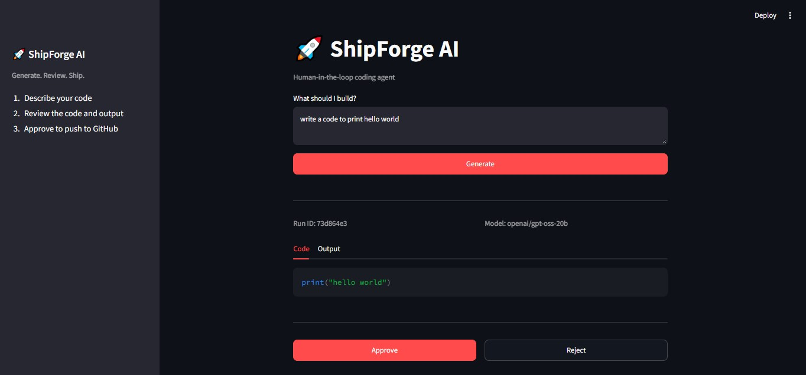
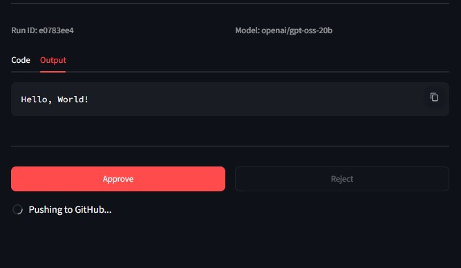
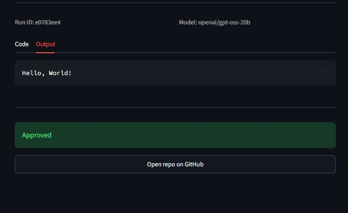
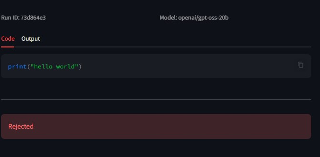
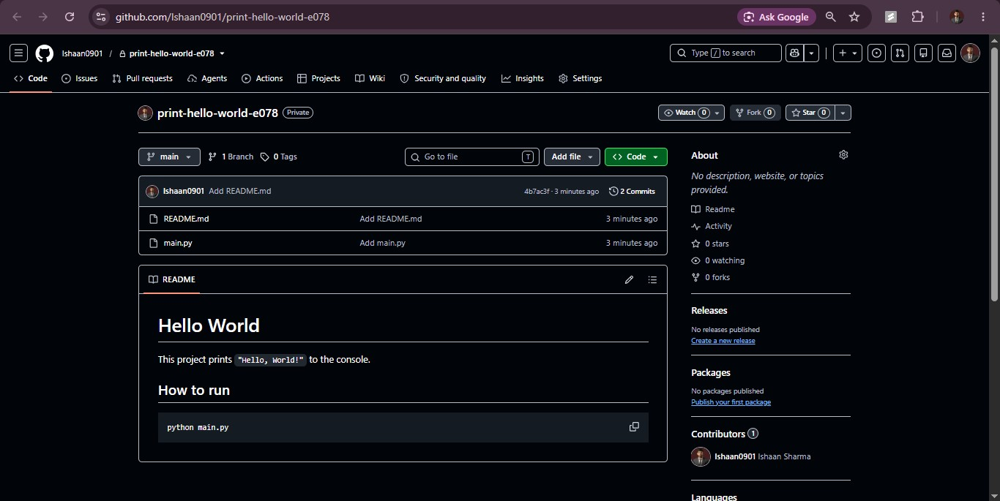

# 🚀 ShipForge AI

A human-in-the-loop coding agent. It writes Python code from your request, tests it in a Docker sandbox, waits for your approval, and only then ships it to GitHub with an auto-generated README.

> **Generate. Review. Ship.**
> The LLM writes the code, but pushing is never under LLM control. A human approves every push.

---

## How It Works

1. You describe what you want built.
2. The LLM writes the code.
3. The code runs inside a Docker sandbox (no network, memory and CPU limits, 10 second timeout).
4. If it fails, the error goes back to the LLM for a fix. Maximum 3 attempts, enforced in the graph.
5. You see the code and output, then **Approve** or **Reject**.
6. On approve, the publish graph scans for secrets, writes a README if missing, and pushes to a new private GitHub repo.

---

## Screenshots

**1. Review the code**


**2. Output and push to GitHub**


**3. Approved with repo link**


**4. Rejected**


**5. Repo created on GitHub**


---

## Features

- **LangGraph workflows:** separate generate graph and publish graph.
- **Human-in-the-loop:** `interrupt` and checkpointing pause the run until you decide. A run can be approved or rejected only once.
- **Retry limit in the graph:** an attempts counter with a conditional edge, not just a line in the prompt.
- **Multi-model fallback:** if a model hits a rate limit, timeout or error, the next one answers. The model used is shown in the UI.
- **Docker sandbox:** generated code never runs directly on the host.
- **Per-run folders:** every run gets its own folder, so runs never share files.
- **Secret scanning before push:** risky files (`.env`, `.pem`, `.key`, `.db`) and token patterns are skipped and never uploaded.
- **Auto README and repo name:** the LLM writes a README if missing and suggests a clean repo name.

---

## Tech Stack

Python, LangGraph, LangChain, Groq, Gemini, FastAPI, Pydantic, Streamlit, SQLite (`langgraph-checkpoint-sqlite`), Docker, PyGithub, pytest.

Model fallback chain: `openai/gpt-oss-20b` → `openai/gpt-oss-120b` → `qwen/qwen3.8-27b` → `gemini-3.1-flash-lite`.

---

## Project Structure

```
app/
  api/        FastAPI endpoints
  agents/     generate graph, publish graph, state
  core/       model fallback, run manager
  tools/      code tools (save, Docker run), GitHub tools
ui/           Streamlit app
tests/        pytest tests
docs/         screenshots
```

---

## Setup

**Requirements:** Python 3.10+, Docker Desktop (running), a Groq API key, a Google API key, a GitHub token (classic, `repo` scope).

```bash
git clone <your-repo-url>
cd ShipForge_AI
python -m venv venv
venv\Scripts\activate          # Windows
pip install -r requirements.txt
```

Create a `.env` file in the project root:

```
GROQ_API_KEY=your_key
GOOGLE_API_KEY=your_key
GITHUB_TOKEN=your_token
RUNS_DIR=./runs
CHECKPOINT_DB=checkpoints.db
```

Never commit `.env`. It is already in `.gitignore`.

---

## Run

Open two terminals in the project root (venv active):

```bash
# Terminal 1: backend
uvicorn app.api.main:app --reload

# Terminal 2: UI
streamlit run ui/app.py
```

Open `http://localhost:8501`. The first run downloads the `python:3.12-slim` Docker image, so it can be slow.

---

## API

| Endpoint | Purpose |
|---|---|
| `POST /generate` | Start a run, returns code, output and `run_id` |
| `POST /approve` | Approve a paused run and publish to GitHub |
| `POST /reject` | Reject a paused run |
| `GET /status/{run_id}` | State of a run |

---

## Tests

```bash
pytest
```

Covers the secret scanner and the Docker sandbox timeout. Docker Desktop must be running.

---

## Security

- Nothing is pushed without explicit approval.
- Generated code runs only inside Docker: no network, 128 MB memory, half a CPU core, 10 second timeout.
- The GitHub token is never given to the sandbox. Pushing happens in the trusted app process.
- Files that look like secrets are skipped before upload. The scanner is pattern based, so it can miss unusual secrets and can raise false alarms. Always review the code before approving.
- New repos are created as **private** by default.

---

## Known Limitations

- The sandbox image has no `pandas` or `sklearn`, so code that needs extra libraries will fail.
- A sandbox pass does not mean the code is correct. The LLM can write code that runs but does the wrong thing, which is why human approval exists.
- Only Python scripts are supported.

---

## Background

ShipForge AI is the next version of DevForge AI (v1, a separate repo). Fixes over v1: retry limit enforced in the graph, one folder per run, Docker sandbox instead of plain `subprocess`, and model fallback.